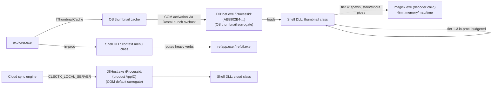

# FUNCTIONAL SPECIFICATION: Crash-Isolated Explorer Thumbnail Extension and Image Toolkit

```
Document:     FS-REF-CR-001
Category:     Clean-room functional specification (informational + normative)
Reference:    the reference product (x64; identity recorded privately); observed as a black box
Date:         2026-10-16
Host:         Windows 11 Pro Insider (build 26340), x64
Status:       Final
```

## Status of This Memo

This document is a clean-room functional specification. It describes the externally observable behaviour of a Windows File Explorer thumbnail and context-menu extension so that an independent team can build a functionally equivalent product. It is written from OS-facing observation only: registry diffs, COM activation and `QueryInterface` probing, process-tree tracing, the CLI's own help and output, the settings UI read through UI Automation, and user documentation shipped in the release package. It contains no source code, disassembly or decompiled control flow from the reference product, and none of its internal symbol names.

The key words "MUST", "MUST NOT", "REQUIRED", "SHALL", "SHALL NOT", "SHOULD", "SHOULD NOT", "RECOMMENDED", "MAY" and "OPTIONAL" are to be read as described in RFC 2119.

Evidence tags used throughout:

| Tag | Meaning |
|---|---|
| **[OBS]** | Directly observed on the test host (registry diff, process trace, COM probe, CLI output, UI Automation dump). |
| **[DOC]** | Stated in user documentation shipped inside the release archive (`README.md`, `PORTABLE.txt`) or in the public package-manager metadata and release notes. Not independently verified. |
| **[INF]** | Engineering inference from [OBS] facts. |

## Table of Contents

1. Scope and Methodology
2. Terminology
3. Architecture and Isolation Model
4. Shell Registration Model
5. Complete File Extension and Category Matrix
6. Context Menu and Conversion Specifications
7. Command-Line Interface
8. Configuration Schema
9. Auxiliary Features (Quick Preview, Screenshots, Quick Action)
10. Persistent State, Files and Network Behaviour
11. Security Considerations
12. Conformance Checklist
13. Clean-Room Attestation

---

## 1. Scope and Methodology

### 1.1 Provisioning decision

| Option | Result |
|---|---|
| A: Windows Sandbox | Rejected. `WindowsSandbox.exe` absent, `VirtualizationFirmwareEnabled = False`, feature query requires elevation. |
| B: Host OS with snapshot and teardown | Selected. |

Baseline snapshots (`reg export`) taken before any product code ran: `HKLM\SOFTWARE\Classes`, `HKCU\Software`, `HKLM\SOFTWARE\Microsoft\Windows\CurrentVersion`, the WOW6432Node equivalents, `RegisteredApplications`, plus the HKLM vendor-root list, the service list, the scheduled-task list and a depth-2 file-system listing of Program Files, ProgramData, AppData, Start Menu and System32.

### 1.2 Package acquisition

| Source | Package | Version | Notes |
|---|---|---|---|
| Chocolatey | (predecessor package) | (version) | Predecessor product, not the target. |
| Chocolatey | (target package) | (version) | Stale relative to upstream. |
| winget | (vendor package id) | (version) | Selected. Inno Setup, machine scope, `elevatesSelf`. Hash verified by winget. |
| GitHub release asset | `<product>-Portable-<version>.zip` | (version) | SHA-256 (recorded privately), matching the published value. |

The machine-scope installer requires UAC consent, and the consent prompt went unanswered in the unattended session, so the installer never ran (no install log was produced). Analysis therefore used the vendor's documented no-administrator path: the portable build plus `refctl register`, which performs the same per-user thumbnail and classic-menu registration. Three installer-only surfaces (preview pane handler, Details-pane property handler, Windows 11 modern menu) are specified from [DOC] and from the product's own diagnostic output, which enumerates their registration slots.

### 1.3 Observation techniques

1. Registry diff, pre-install vs post-registration vs post-teardown.
2. COM probing: `CoCreateInstance` of each registered class followed by `QueryInterface` for 17 well-known shell IIDs.
3. Forced extraction through the OS thumbnail cache (`IThumbnailCache::GetThumbnail` with `WTS_FORCEEXTRACTION | WTS_EXTRACTDONOTCACHE`) while a watcher recorded process creation, parent PIDs, command lines and module maps.
4. Context-menu enumeration: `IShellItem::BindToHandler(BHID_SFUIObject, IID_IContextMenu)`, then `QueryContextMenu`, with submenus walked via `IContextMenu2::HandleMenuMsg(WM_INITMENUPOPUP)`.
5. Settings UI enumeration via UI Automation plus Win32 control queries (`BM_GETCHECK`, `CB_GETLBTEXT`).
6. CLI exercise of every subcommand against valid, truncated, empty, random-byte and decompression-bomb inputs, under a process-tree tracer.

---

## 2. Terminology

| Term | Definition |
|---|---|
| Shell DLL | The in-process COM server holding every shell-facing class. |
| App | The GUI executable: settings, dialogs, tray, Quick preview, screenshot tool, hotkey daemon. |
| CLI | The console executable: batch tooling, diagnostics, MCP server, registration. |
| Decoder child | A short-lived, resource-limited external process used for the long tail of image formats. |
| Tier | One decoder stage in the ordered fallback chain (Section 3.4). |
| Thumbnail surrogate | Windows' own isolated `DllHost.exe` that hosts thumbnail providers (AppID `{AB8902B4-09CA-4BB6-B78D-A8F59079A8D5}`, a Microsoft-defined identifier). |

---

## 3. Architecture and Isolation Model

### 3.1 Component inventory [OBS]

Portable release layout (file names only):

```
<root>\
  refapp.exe          GUI app (settings, dialogs, tray, Quick preview, screenshot/hotkey daemon)
  refctl.exe                  CLI + MCP server
  refshell.dll          Shell DLL (all COM classes)
  ref_dlghook.dll          Helper DLL (Quick preview inside Open/Save dialogs [DOC]; never seen loaded in tests)
  magick.exe                Decoder child host (bundled ImageMagick)
  CORE_RL_*.dll             Decoder child runtime libraries (heif, jpeg-xl, openjpeg, raw, tiff, webp, ...)
  modules\coders\IM_MOD_RL_*.dll   ~110 per-format coder modules
  modules\filters\FILTER_RL_analyze_.dll
  policy.xml                Hardened decoder security policy (Section 11.2)
  colors.xml configure.xml delegates.xml english.xml locale.xml log.xml mime.xml thresholds.xml type*.xml
  msvcp140.dll vcruntime140*.dll vcomp140.dll   VC++ runtime (app-local)
  RefProduct.ini          PORTABLE MODE MARKER + settings store
  upload-hosts.conf         Created on first use (Section 10.3)
  RefProduct-update.txt   Created by the update checker (Section 10.4)
  README.md PORTABLE.txt License.txt NOTICE.txt LICENSE-DejaVu.txt app.ico logo.png banner.png
```

A conforming implementation SHALL provide equivalent roles:

| Role | Process placement | Required |
|---|---|---|
| Thumbnail provider class | Shell DLL, hosted by the OS thumbnail surrogate | MUST |
| Cloud-folder thumbnail provider class | Shell DLL, hosted in a COM default surrogate | SHOULD |
| Classic context menu class | Shell DLL, in the caller's process (Explorer) | MUST |
| Preview handler class (installer) | Shell DLL, `prevhost.exe` | SHOULD [DOC] |
| Property handler class (installer) | Shell DLL, Explorer / property system | SHOULD [DOC] |
| Modern menu class, `IExplorerCommand` (installer) | Shell DLL via sparse package identity | SHOULD [DOC] |
| Decoder child | Separate process per decode | MUST |
| GUI app and background daemon | Separate processes | MUST for the toolkit |
| CLI | Separate process | MUST |

### 3.2 COM classes and interfaces

The following was determined empirically by `QueryInterface` on live instances [OBS]. `IMarshal` answered on every class, consistent with aggregating the free-threaded marshaller [INF].

| Class (role) | Responds YES | Responds E_NOINTERFACE |
|---|---|---|
| Thumbnail provider | `IThumbnailProvider`, `IInitializeWithStream`, `IMarshal` | `IInitializeWithFile`, `IInitializeWithItem`, `IExtractImage`, `IExtractImage2`, `IPersistFile`, `IObjectWithSite`, `IShellExtInit`, all menu, preview and property IIDs |
| Cloud-folder thumbnail provider | `IThumbnailProvider`, `IInitializeWithItem`, `IMarshal` | `IInitializeWithStream`, `IInitializeWithFile`, `IExtractImage*`, `IPersistFile`, others |
| Classic context menu | `IShellExtInit`, `IContextMenu`, `IContextMenu2`, `IContextMenu3`, `IMarshal` | `IExplorerCommand`, `IObjectWithSite`, thumbnail IIDs |
| Preview handler [DOC] | `IPreviewHandler` plus the usual `IInitializeWith*` / `IObjectWithSite` / `IOleWindow` set [INF] | n/a |
| Property handler [DOC] | `IPropertyStore` (read-only), `IInitializeWithStream` [INF] | n/a |
| Modern menu [DOC] | `IExplorerCommand` (+ `IEnumExplorerCommand` for submenus) [INF] | n/a |

Normative requirements:

- **REQ-COM-1** The thumbnail class MUST implement `IThumbnailProvider` and `IInitializeWithStream`, and MUST NOT implement `IInitializeWithFile` or `IExtractImage`. Stream-only initialisation is what keeps the handler eligible for the OS isolated surrogate.
- **REQ-COM-2** The cloud-folder class MUST implement `IThumbnailProvider` and `IInitializeWithItem`, and MUST be activatable out-of-process (`CLSCTX_LOCAL_SERVER`) through a registered AppID with an empty `DllSurrogate` value.
- **REQ-COM-3** The classic menu class MUST implement `IShellExtInit`, `IContextMenu`, `IContextMenu2` and `IContextMenu3` (owner-drawn preview item, lazily populated submenus).
- **REQ-COM-4** Every class MUST use `ThreadingModel = Apartment` [OBS] under `InprocServer32`.
- **REQ-COM-5** The new implementation MUST generate fresh CLSIDs and AppIDs for all of its own classes. Reference-product identifiers are intentionally not reproduced in this document. Only Microsoft-defined identifiers (interface IIDs, handler-category keys, OS surrogate AppIDs) appear here.
- **REQ-COM-6** `IThumbnailProvider::GetThumbnail` MUST return a top-down 32-bpp premultiplied BGRA DIB with `WTSAT_ARGB` [OBS: the OS cache reported alpha type 2 for every successful extraction].
- **REQ-COM-7** On any decode failure, `GetThumbnail` MUST return a failure HRESULT (observed: `E_FAIL`, which the cache surfaces as `WTS_E_FAILEDEXTRACTION` 0x8004B200). It MUST NOT crash, hang the host past the budgets in 3.5, or return a placeholder bitmap.

### 3.3 Process isolation strategy [OBS]



Observed facts:

1. A forced extraction caused `svchost.exe` (DcomLaunch) to start `DllHost.exe /Processid:{AB8902B4-09CA-4BB6-B78D-A8F59079A8D5}`, and the Shell DLL was mapped into it within about 80 ms.
2. The thumbnail class registration carries no `DisableProcessIsolation` value, so Windows' default out-of-process isolation applies.
3. Every long-tail decode created a `magick.exe` child whose parent was that surrogate `DllHost.exe`, not Explorer.
4. Activating the cloud class with `CLSCTX_LOCAL_SERVER` started `DllHost.exe /Processid:{<product AppID>}` (empty `DllSurrogate`), which mapped the Shell DLL.
5. The context-menu class loads in-process into the calling process (Explorer, or the probe's PowerShell host in testing).
6. Heavy menu verbs are routed out of the shell process. The CLI help names `clip-pixels`, `wallpaper-prepare` and `folder-icon` as the back ends for the "routed" menu verbs, so a decode crash on those paths cannot take down Explorer [OBS help text].

Requirements:

- **REQ-ISO-1** The thumbnail provider MUST run out-of-process under the OS thumbnail surrogate. It MUST NOT set `DisableProcessIsolation`.
- **REQ-ISO-2** Decoders without a memory-safety guarantee (any C/C++ codec library) MUST run in a separate child process per request, never in the surrogate.
- **REQ-ISO-3** In-process decoders MUST be panic- and exception-contained so that a fault in one decode returns a failure HRESULT instead of terminating the surrogate.
- **REQ-ISO-4** The context menu handler MUST do no image decoding on Explorer's UI thread, apart from the single small menu-preview thumbnail (which SHOULD reuse the isolated thumbnail path). Multi-file jobs MUST be delegated to the App or CLI process.
- **REQ-ISO-5** Files flagged online-only by a cloud provider (`FILE_ATTRIBUTE_RECALL_ON_DATA_ACCESS`, `FILE_ATTRIBUTE_RECALL_ON_OPEN`, `FILE_ATTRIBUTE_OFFLINE`) MUST NOT be read to make a thumbnail [DOC release notes].

### 3.4 Decoder tier chain

Ordered fallback: the first tier that succeeds wins [DOC, consistent with OBS process traces].

| Order | Tier | Placement | Examples |
|---|---|---|---|
| 0 | Format sniff / special routing | in-proc | SVG detected up front and sent to the vector renderer |
| 1 | Memory-safe native decoders | in-proc (surrogate) | PNG, JPEG, GIF, BMP, TGA, WebP, QOI, ICO, DDS, EXR, embedded previews (PSD, RAW, Blender, 3MF, Office, ebooks), audio cover art |
| 2 | OS codecs: WIC and Media Foundation | in-proc (surrogate) | HEIC/HEIF/AVCI (WIC HEIF + HEVC extension), JPEG XR family (WIC), most video (MF) |
| 3 | Product-owned helper processes | short-lived child | AVIF decode, FLV (VP6/Sorenson), VP9 profile 2/3, 10-bit H.264, MPEG-1/2 [DOC] |
| 4 | Sandboxed external decoder | `magick.exe` child | XCF, PCX, SGI, DPX, FITS, MIFF, PDB, legacy long tail |
| 5 | Headerless fallback | in-proc | Headerless Targa sniff [DOC] |

Observed tier-4 invocation (thumbnail path), byte-exact:

```
magick.exe -limit memory 512MiB -limit map 1GiB -limit time 120 - -strip -resize <N>x<N>> PNG:-
```

- Input arrives on **stdin** and output is a PNG on **stdout** (`PNG:-`). The file path is never passed in the normal case.
- **Seekable retry:** when stdin decoding fails for a container that needs random access (observed with `.cr2`), the file is copied to `%TEMP%\refctl-coder-<pid>-<seq>.<ext>` and the child is re-run with that path [OBS].
- `<N>` equals the requested thumbnail edge (96 and 256 observed for Explorer views, 256 for the CLI default), and `>` means shrink only.
- Batch thumbnailing ran up to 5 decoder children concurrently [OBS].

Observed tier-4 invocation (conversion path):

```
magick.exe -limit memory 512MiB -limit map 1GiB -limit time 600 png:- <FMT>:<dest>.<pid>-<seq>.reftmp
```

- Conversion always feeds the child an already-decoded PNG from the parent, so the child only ever reads a trusted, product-produced PNG [OBS].
- Output goes to a temporary sibling file that is renamed onto the destination on success (atomic replace) [OBS].

**REQ-DEC-1** The external decoder MUST receive input via an anonymous pipe and return PNG via pipe. File-path input is permitted only as a seekable-retry fallback using a uniquely named temp copy, which MUST be deleted afterwards.

**REQ-DEC-2** Every decoder child MUST be launched with explicit memory, map and elapsed-time limits no higher than those in Section 3.5, and under a policy file that denies dangerous coders (Section 11.2).

**REQ-DEC-3** Writes MUST be atomic (temp sibling, then rename). A failed conversion MUST leave no partial destination file.

### 3.5 Timeout and resource budgets

| Budget | Value | Evidence |
|---|---|---|
| Decoder child memory | 512 MiB | [OBS] command line, policy ceiling |
| Decoder child memory-map | 1 GiB | [OBS] command line, policy ceiling |
| Decoder child elapsed time, thumbnail | 120 s | [OBS] `-limit time 120` |
| Decoder child elapsed time, conversion | 600 s | [OBS] `-limit time 600` (policy ceiling 600) |
| Decoder child pixel area | 512 MP | [OBS] policy ceiling |
| Decoder child disk spill | 2 GiB | [OBS] policy ceiling |
| Decoder child image-list length | 256 frames | [OBS] policy ceiling |
| Decoder child CPU budget | about 20 s, with a parent watchdog that kills the child | [DOC] (policy file annotation) |
| In-process vector render budget | about 10 s | [OBS] a heavy-filter SVG failed after 10.4 s (cache path) and 11.6 s (CLI), without crashing the host |
| Recursive-reference guard | Rejected after about 3 s | [OBS] a 10^9-element nested `<use>` SVG failed in 3.0-3.7 s, then fell through to tier 4, which refuses SVG |
| Repeat-failure fast path | about 40 ms | [OBS] a second request for a just-failed file at a new size returned in 40 ms |
| Max source file size | 4096 MB (user setting) | [OBS] Settings and doctor; larger files are skipped |
| Max produced thumbnail edge | 1024 px (user setting) | [OBS] |
| Decompression-bomb guard | Header dimensions checked before allocation | [OBS] a 33-byte PNG declaring 65535x65535 was rejected in under 1.2 s |

- **REQ-TMO-1** Every tier MUST be bounded by a wall-clock and/or CPU budget. Exceeding it MUST abort the decode and return failure for that tier. The implementation SHOULD continue to the next tier only if the failure was a decode error, not a budget exhaustion on a hostile input.
- **REQ-TMO-2** The parent MUST hold a kill-on-timeout watchdog over each child, independent of the child's self-imposed limits. Assigning children to a Job Object with `JOB_OBJECT_LIMIT_KILL_ON_JOB_CLOSE` and a per-process memory limit is RECOMMENDED [INF].
- **REQ-TMO-3** The provider SHOULD cache negative results per (path, size, mtime) for the life of the surrogate, so Explorer's multi-size requests do not repeat an expensive failure.
- **REQ-TMO-4** The size gate (Max file size) MUST be checked from metadata before any read.

### 3.6 Diagnostics log [OBS]

- One shared append-only log at `%LOCALAPPDATA%\RefProduct.log`, written by all components.
- Every process writes a header line on start: `[pid N +0ms] ==== <Product> <ver> [dll|app|refctl] · <Windows edition and build> ====`.
- Failures add a line such as `ERROR GetThumbnail: failed hr=0x80004005 ext=<ext> size=<bytes>`.
- A "Verbose logging" setting enables detailed traces (Section 8).

---

## 4. Shell Registration Model

### 4.1 Per-user registration (portable / `register` path) [OBS]

`refctl register` added 2,055 keys under `HKCU\Software\Classes`. It removed nothing and modified nothing else apart from OS bookkeeping; `GlobalAssocChangedCounter` was incremented, consistent with an `SHChangeNotify(SHCNE_ASSOCCHANGED)` broadcast [INF]. No HKLM, service, scheduled task or Run-key changes.

| Key pattern | Count | Value |
|---|---|---|
| `CLSID\{<thumb>}` + `\InprocServer32` | 1 | Default `"<Product> Thumbnail Provider"`; `InprocServer32 = <abs path to Shell DLL>`, `ThreadingModel = Apartment` |
| `CLSID\{<menu>}` + `\InprocServer32` | 1 | Default `"<Product> Context Menu"`; same InprocServer32 shape |
| `CLSID\{<cloud>}` + `\InprocServer32` | 1 | Default `"<Product> Cloud Folder Thumbnail Provider"`, `AppID = {<cloudAppID>}`; same InprocServer32 shape |
| `AppID\{<cloudAppID>}` | 1 | Default name, `DllSurrogate = ""` (empty string means use the system default surrogate) |
| `*\shellex\ContextMenuHandlers\<ProductName>` | 1 | Default = `{<menu>}` |
| `.<ext>` (created only when absent) | as needed | No default value written, so open-with associations are untouched |
| `.<ext>\shellex\{E357FCCD-A995-4576-B01F-234630154E96}` | 363 | Default = `{<thumb>}` |
| `SystemFileAssociations\.<ext>\shellex\{E357FCCD-A995-4576-B01F-234630154E96}` | 363 | Default = `{<thumb>}` |

`{E357FCCD-A995-4576-B01F-234630154E96}` is the Microsoft-defined `IThumbnailProvider` handler-category key.

- **REQ-REG-1** Thumbnail handlers MUST be registered at both `.<ext>\shellex` and `SystemFileAssociations\.<ext>\shellex`, so the handler is found regardless of which ProgID owns the extension.
- **REQ-REG-2** Registration MUST NOT set or change an extension's default value (ProgID) or any `OpenWithProgids` entry.
- **REQ-REG-3** Only formats enabled in the File types setting are registered; toggling a type MUST add or remove exactly its two keys and then broadcast `SHCNE_ASSOCCHANGED`.
- **REQ-REG-4** Unregistration MUST remove every key it created, including the `.<ext>` and `SystemFileAssociations` parent keys it created, and MUST leave pre-existing keys intact. Observed deviation in the reference: `register --off` removed 2,054 of the 2,055 keys that `register` had added (all class, AppID, handler and created `.<ext>` keys). The one left behind was the empty `HKCU\Software\Classes\SystemFileAssociations` parent, which did not exist before registration. The new implementation MUST NOT repeat this (see Section 13).
- **REQ-REG-5** The per-user path MUST NOT require elevation and MUST NOT touch HKLM.
- **REQ-REG-6** A portable copy MUST refuse per-user registration when it detects it is not portable (observed message: per-user registration from an installed copy would "survive uninstall and block thumbnails"), and MUST offer an `--off` path [OBS].
- **REQ-REG-7** Precedence caveat: a ProgID-level `ShellEx\{E357FCCD...}` or `ShellEx\{BB2E617C...}` (IExtractImage) handler on the extension's ProgID wins over extension-level registration. The diagnostic tool MUST detect and report such foreign handlers [OBS: doctor reported `.ico -> icofile` handlers].

### 4.2 Machine-wide registration (installer path) [DOC]

The installer registers the Shell DLL via `regsvr32` (`DllRegisterServer`) under HKLM. It adds:

- **Preview handler:** `{8895B1C6-B41F-4C1C-A562-0D564250836F}` shellex, plus an entry in `...\PreviewHandlers` with an `AppID` for `prevhost.exe`.
- **Property handler:** `...\PropertySystem\PropertyHandlers\.<ext>`.
- **Approved Shell Extensions** entries for all five classes. The diagnostic tool checks for these [OBS doctor output].
- **Windows 11 modern menu:** a sparse MSIX package signed with a self-signed certificate that the installer trusts.
- **Business/personal choice:** made at install time; it cannot be changed later in Settings.

Since 3.7.1 the installer no longer writes to the Run key, creates scheduled tasks via `schtasks.exe`, or restarts Explorer.

- **REQ-REG-8** The installer MUST be per-machine and elevated. It MUST register all five handler classes and add them to `Shell Extensions\Approved`. Its uninstaller MUST remove all of it.
- **REQ-REG-9** The new implementation's modern-menu package MUST use a freshly issued signing identity and fresh GUIDs.

### 4.3 Cloud-folder thumbnails [OBS + DOC]

A separate class (Section 3.2) is registered for cloud sync roots (OneDrive, Synology Drive and similar), where Windows asks only the sync root's registered thumbnail provider. It is OFF by default. Doctor output: "Thumbnails in cloud folders: off (Settings -> General turns it on)", with per-provider link state (for example, OneDrive "not linked"). When enabled, the product links its cloud class to the sync root [INF]. It MUST honour REQ-ISO-5.

---

## 5. Complete File Extension and Category Matrix

Source of truth: `refctl formats --json` [OBS], 363 entries. The diagnostic tool's capability totals were full decode 161, embedded preview 97, cover or first page 58, video frame 26, cover art 18, contained images 3.

Thumbnail source semantics:

| Source | Meaning |
|---|---|
| Full decode | Pixels decoded from the primary image data. |
| Embedded preview | Preview or thumbnail stored inside the file (EXIF/JPEG preview in RAW, PSD composite or thumbnail resource, project-file preview, package icon); no host app needed. |
| Cover / first page | Ebook or comic cover (with "prefer cover" heuristics), or page 1 of a document. |
| Embedded cover art | Album art from tags; for WAV/AIFF, a waveform when no art exists. |
| Representative frame | Video frame at a configurable % offset (default 30%), via Media Foundation or the product's own helper process. |
| Contact sheet | Grid of images contained in an archive, subject to the max file size limit. |

"Requires OS codec" means the format thumbnails only if the named Windows component is present; the diagnostic tool probes and reports each. "Convertible = no" means the format is not accepted as a Convert input.

### 5.1 Image: raster, HDR, vector, icon, texture (full decode) (161)

| Ext | Description | Thumbnail source | Requires OS codec | Convertible |
|---|---|---|---|---|
| .apng | Animated Portable Network Graphics | Full decode | - | yes |
| .avci | AVC Image File Format | Full decode | WIC HEIF + HEVC extension | yes |
| .avif | AV1 Image File Format | Full decode | - | yes |
| .avifs | AV1 Image File Format sequence | Full decode | - | yes |
| .ani | Windows animated cursor | Full decode | - | yes |
| .bmp | Microsoft Windows bitmap image | Full decode | - | yes |
| .bw | Silicon Graphics (B&W) | Full decode | - | yes |
| .cal | Continuous Acquisition and Life-cycle Support | Full decode | - | yes |
| .cals | Continuous Acquisition and Life-cycle Support | Full decode | - | yes |
| .cin | Cineon Image File | Full decode | - | yes |
| .cur | Microsoft icon | Full decode | - | yes |
| .cut | DR Halo | Full decode | - | yes |
| .dcm | DICOM medical image | Full decode | - | yes |
| .dcx | ZSoft IBM PC multi-page Paintbrush | Full decode | - | yes |
| .dds | Microsoft DirectDraw Surface | Full decode | - | yes |
| .dib | Windows DIB | Full decode | - | yes |
| .dicom | DICOM medical image | Full decode | - | yes |
| .dpx | SMPTE 268M-2003 | Full decode | - | yes |
| .dxt1 | Microsoft DirectDraw Surface | Full decode | - | yes |
| .dxt5 | Microsoft DirectDraw Surface | Full decode | - | yes |
| .emf | Windows Enhanced Metafile | Full decode | - | yes |
| .emz | Compressed Windows Enhanced Metafile | Full decode | - | yes |
| .exr | High Dynamic-range (OpenEXR) | Full decode | - | yes |
| .farbfeld | Farbfeld | Full decode | - | yes |
| .ff | Farbfeld | Full decode | - | yes |
| .fits | Flexible Image Transport System | Full decode | - | yes |
| .fl32 | FilmLight | Full decode | - | yes |
| .fts | Flexible Image Transport System | Full decode | - | yes |
| .gif | CompuServe graphics interchange format | Full decode | - | yes |
| .hdr | Radiance RGBE image format | Full decode | - | yes |
| .heic | High Efficiency Image Format | Full decode | WIC HEIF + HEVC extension | yes |
| .heif | High Efficiency Image Format | Full decode | WIC HEIF + HEVC extension | yes |
| .livp | Apple Live Photo | Full decode | - | yes |
| .icb | Truevision Targa image | Full decode | - | yes |
| .ico | Microsoft icon | Full decode | - | yes |
| .icon | Microsoft icon | Full decode | - | yes |
| .j2c | JPEG-2000 Code Stream Syntax | Full decode | - | yes |
| .j2k | JPEG-2000 Code Stream Syntax | Full decode | - | yes |
| .jfif | JPEG/JFIF | Full decode | - | yes |
| .jng | JPEG Network Graphics | Full decode | - | yes |
| .jnx | Garmin tile format | Full decode | - | yes |
| .jp2 | JPEG-2000 File Format Syntax | Full decode | - | yes |
| .jpc | JPEG-2000 Code Stream Syntax | Full decode | - | yes |
| .jpe | JPEG (JFIF) | Full decode | - | yes |
| .jpeg | JPEG (JFIF) | Full decode | - | yes |
| .jpg | JPEG (JFIF) | Full decode | - | yes |
| .jpm | JPEG-2000 File Format Syntax | Full decode | - | yes |
| .jps | Stereo JPEG | Full decode | - | yes |
| .jxl | JPEG XL (ISO/IEC 18181) | Full decode | - | yes |
| .jxr | JPEG XR (ISO/IEC 29199-2) | Full decode | WIC JPEG XR | yes |
| .wdp | HD Photo / Windows Media Photo (JPEG XR) | Full decode | WIC JPEG XR | yes |
| .hdp | HD Photo (JPEG XR) | Full decode | WIC JPEG XR | yes |
| .mac | MacPaint | Full decode | - | yes |
| .mat | MATLAB level 5 image format | Full decode | - | yes |
| .miff | Magick Image File Format | Full decode | - | yes |
| .mng | Multiple-image Network Graphics | Full decode | - | yes |
| .mpo | Multi-Picture (3D) JPEG | Full decode | - | yes |
| .stl | Stereolithography 3D model | Full decode | - | yes |
| .obj | Wavefront 3D model | Full decode | - | yes |
| .ply | Polygon File Format 3D model | Full decode | - | yes |
| .pam | Portable Arbitrary Map | Full decode | - | yes |
| .pbm | Portable bitmap format | Full decode | - | yes |
| .pcd | Photo CD | Full decode | - | yes |
| .pcx | ZSoft IBM PC Paintbrush | Full decode | - | yes |
| .pdb | Palm Database ImageViewer Format | Full decode | - | yes |
| .pfm | Portable float format | Full decode | - | yes |
| .pgm | Portable graymap format | Full decode | - | yes |
| .pgx | JPEG 2000 uncompressed format | Full decode | - | yes |
| .phm | Portable half float format | Full decode | - | yes |
| .pix | Alias/Wavefront RLE image format | Full decode | - | yes |
| .png | Portable Network Graphics | Full decode | - | yes |
| .pnm | Portable anymap | Full decode | - | yes |
| .ppm | Portable pixmap format | Full decode | - | yes |
| .ptif | Pyramid encoded TIFF | Full decode | - | yes |
| .pwp | Seattle Film Works | Full decode | - | yes |
| .qoi | Quite OK image format | Full decode | - | yes |
| .ras | SUN Rasterfile | Full decode | - | yes |
| .rla | Alias/Wavefront image | Full decode | - | yes |
| .rle | Utah Run length encoded image | Full decode | - | yes |
| .rmf | Raw Media Format | Full decode | - | yes |
| .scr | ZX-Spectrum SCREEN$ | Full decode | - | yes |
| .sct | Scitex HandShake | Full decode | - | yes |
| .sf3 | Simple File Format Family Images | Full decode | - | yes |
| .sfw | Seattle Film Works | Full decode | - | yes |
| .sgi | Silicon Graphics RGB | Full decode | - | yes |
| .six | DEC SIXEL graphics | Full decode | - | yes |
| .sixel | DEC SIXEL graphics | Full decode | - | yes |
| .sti | Sinar CaptureShop Raw Format | Full decode | - | yes |
| .sun | SUN Rasterfile | Full decode | - | yes |
| .svg | Scalable Vector Graphics | Full decode | - | yes |
| .svgz | Compressed Scalable Vector Graphics | Full decode | - | yes |
| .tga | Truevision Targa image | Full decode | - | yes |
| .tif | Tagged Image File Format | Full decode | - | yes |
| .tiff | Tagged Image File Format | Full decode | - | yes |
| .tiff64 | Tagged Image File Format (64-bit) | Full decode | - | yes |
| .tim | PSX TIM | Full decode | - | yes |
| .tm2 | PS2 TIM2 | Full decode | - | yes |
| .vda | Truevision Targa image | Full decode | - | yes |
| .vicar | Video Image Communication And Retrieval | Full decode | - | yes |
| .viff | Khoros Visualization image | Full decode | - | yes |
| .vips | VIPS image | Full decode | - | yes |
| .vtf | Valve Texture Format | Full decode | - | yes |
| .ktx | Khronos texture (KTX 1) | Full decode | - | yes |
| .vst | Truevision Targa image | Full decode | - | yes |
| .webp | Google WebP | Full decode | - | yes |
| .wmf | Windows Metafile | Full decode | - | yes |
| .wpg | Word Perfect Graphics | Full decode | - | yes |
| .xbm | X Windows system bitmap | Full decode | - | yes |
| .xcf | GIMP image | Full decode | - | yes |
| .xpm | X Windows system pixmap | Full decode | - | yes |
| .xv | Khoros Visualization image | Full decode | - | yes |
| .heics | HEIF image sequence | Full decode | WIC HEIF + HEVC extension | yes |
| .heifs | HEIF image sequence | Full decode | WIC HEIF + HEVC extension | yes |
| .hif | High Efficiency Image Format | Full decode | WIC HEIF + HEVC extension | yes |
| .jpf | JPEG-2000 File Format Syntax | Full decode | - | yes |
| .jpx | JPEG-2000 Part-2 (extended) | Full decode | - | yes |
| .rgbe | Radiance RGBE image format | Full decode | - | yes |
| .xyze | Radiance XYZE image format | Full decode | - | yes |
| .hdri | Radiance HDR image format | Full decode | - | yes |
| .cxr | OpenEXR image | Full decode | - | yes |
| .wmp | HD Photo / Windows Media Photo (JPEG XR) | Full decode | WIC JPEG XR | yes |
| .wmz | Compressed Windows Metafile | Full decode | - | yes |
| .emg | Windows Enhanced Metafile | Full decode | - | yes |
| .tpic | Truevision Targa image | Full decode | - | yes |
| .pdd | Adobe Photoshop bitmap | Full decode | - | yes |
| .psdt | Adobe Photoshop template | Full decode | - | yes |
| .aftemplate | Affinity template document | Full decode | - | yes |
| .skb | SketchUp backup model | Full decode | - | yes |
| .ph | Photo CD | Full decode | - | yes |
| .blend1 | Blender auto-save backup | Full decode | - | yes |
| .blend2 | Blender auto-save backup | Full decode | - | yes |
| .blend3 | Blender auto-save backup | Full decode | - | yes |
| .blend4 | Blender auto-save backup | Full decode | - | yes |
| .blend5 | Blender auto-save backup | Full decode | - | yes |
| .blend6 | Blender auto-save backup | Full decode | - | yes |
| .blend7 | Blender auto-save backup | Full decode | - | yes |
| .blend8 | Blender auto-save backup | Full decode | - | yes |
| .blend9 | Blender auto-save backup | Full decode | - | yes |
| .blend10 | Blender auto-save backup | Full decode | - | yes |
| .blend11 | Blender auto-save backup | Full decode | - | yes |
| .blend12 | Blender auto-save backup | Full decode | - | yes |
| .blend13 | Blender auto-save backup | Full decode | - | yes |
| .blend14 | Blender auto-save backup | Full decode | - | yes |
| .blend15 | Blender auto-save backup | Full decode | - | yes |
| .blend16 | Blender auto-save backup | Full decode | - | yes |
| .blend17 | Blender auto-save backup | Full decode | - | yes |
| .blend18 | Blender auto-save backup | Full decode | - | yes |
| .blend19 | Blender auto-save backup | Full decode | - | yes |
| .blend20 | Blender auto-save backup | Full decode | - | yes |
| .blend21 | Blender auto-save backup | Full decode | - | yes |
| .blend22 | Blender auto-save backup | Full decode | - | yes |
| .blend23 | Blender auto-save backup | Full decode | - | yes |
| .blend24 | Blender auto-save backup | Full decode | - | yes |
| .blend25 | Blender auto-save backup | Full decode | - | yes |
| .blend26 | Blender auto-save backup | Full decode | - | yes |
| .blend27 | Blender auto-save backup | Full decode | - | yes |
| .blend28 | Blender auto-save backup | Full decode | - | yes |
| .blend29 | Blender auto-save backup | Full decode | - | yes |
| .blend30 | Blender auto-save backup | Full decode | - | yes |
| .blend31 | Blender auto-save backup | Full decode | - | yes |
| .blend32 | Blender auto-save backup | Full decode | - | yes |

### 5.2 Image: design, CAD, 3D, package and project files (embedded preview) (63)

| Ext | Description | Thumbnail source | Requires OS codec | Convertible |
|---|---|---|---|---|
| .ai | Adobe Illustrator (PDF-compatible) | Embedded preview | - | yes |
| .cdr | CorelDRAW drawing | Embedded preview | - | yes |
| .cdt | CorelDRAW template | Embedded preview | - | yes |
| .cmx | Corel Presentation Exchange | Embedded preview | - | yes |
| .eps | Encapsulated PostScript (embedded preview) | Embedded preview | - | yes |
| .icns | Apple Icon Image | Embedded preview | - | yes |
| .iff | Amiga IFF ILBM image | Embedded preview | - | yes |
| .ilbm | Amiga IFF ILBM image | Embedded preview | - | yes |
| .lbm | Deluxe Paint ILBM image | Embedded preview | - | yes |
| .ora | OpenRaster format | Embedded preview | - | yes |
| .kra | Krita document | Embedded preview | - | yes |
| .3mf | 3D Manufacturing Format | Embedded preview | - | yes |
| .fcstd | FreeCAD document | Embedded preview | - | yes |
| .fcbak | FreeCAD backup document | Embedded preview | - | yes |
| .fcstd1 | FreeCAD backup document | Embedded preview | - | yes |
| .f3d | Autodesk Fusion 360 archive | Embedded preview | - | yes |
| .gcode | 3D-printer G-code (sliced) | Embedded preview | - | yes |
| .gco | 3D-printer G-code (sliced) | Embedded preview | - | yes |
| .afphoto | Affinity Photo document | Embedded preview | - | yes |
| .afdesign | Affinity Designer document | Embedded preview | - | yes |
| .afpub | Affinity Publisher document | Embedded preview | - | yes |
| .af | Affinity document | Embedded preview | - | yes |
| .blend | Blender scene | Embedded preview | - | yes |
| .clip | Clip Studio Paint document | Embedded preview | - | yes |
| .pxo | Pixelorama project | Embedded preview | - | yes |
| .aseprite | Aseprite sprite | Embedded preview | - | yes |
| .ase | Aseprite sprite | Embedded preview | - | yes |
| .bgcode | 3D-printer G-code (binary) | Embedded preview | - | yes |
| .sldprt | SolidWorks part | Embedded preview | - | yes |
| .sldasm | SolidWorks assembly | Embedded preview | - | yes |
| .slddrw | SolidWorks drawing | Embedded preview | - | yes |
| .mcworld | Minecraft Bedrock world | Embedded preview | - | yes |
| .mctemplate | Minecraft Bedrock world template | Embedded preview | - | yes |
| .mcpack | Minecraft Bedrock pack | Embedded preview | - | yes |
| .mcaddon | Minecraft Bedrock add-on | Embedded preview | - | yes |
| .spla | SpriteLoop animation package | Embedded preview | - | yes |
| .pspimage | Paint Shop Pro image | Embedded preview | - | yes |
| .psp | Paint Shop Pro image | Embedded preview | - | yes |
| .pspbrush | Paint Shop Pro brush | Embedded preview | - | yes |
| .pspframe | Paint Shop Pro picture frame | Embedded preview | - | yes |
| .psptube | Paint Shop Pro picture tube | Embedded preview | - | yes |
| .pspshape | Paint Shop Pro preset shape | Embedded preview | - | yes |
| .pspselection | Paint Shop Pro selection | Embedded preview | - | yes |
| .pspmask | Paint Shop Pro mask | Embedded preview | - | yes |
| .tub | Paint Shop Pro picture tube (legacy) | Embedded preview | - | yes |
| .sketch | Sketch design document | Embedded preview | - | yes |
| .procreate | Procreate document | Embedded preview | - | yes |
| .skp | SketchUp model | Embedded preview | - | yes |
| .dwg | AutoCAD drawing | Embedded preview | - | yes |
| .dxf | AutoCAD drawing exchange | Embedded preview | - | yes |
| .3dm | Rhino 3D model | Embedded preview | - | yes |
| .xd | Adobe XD design | Embedded preview | - | yes |
| .max | Autodesk 3ds Max scene | Embedded preview | - | yes |
| .c4d | Cinema 4D scene | Embedded preview | - | yes |
| .apk | Android application package | Embedded preview | - | yes |
| .apks | Android split-APK bundle | Embedded preview | - | yes |
| .xapk | Android split-APK bundle (XAPK) | Embedded preview | - | yes |
| .apkm | Android split-APK bundle (APKM) | Embedded preview | - | yes |
| .nupkg | NuGet package | Embedded preview | - | yes |
| .vsix | Visual Studio extension package | Embedded preview | - | yes |
| .pdn | Paint.NET image | Embedded preview | - | yes |
| .psb | Adobe Large Document Format | Embedded preview | - | yes |
| .psd | Adobe Photoshop bitmap | Embedded preview | - | yes |

### 5.3 Camera RAW (34)

| Ext | Description | Thumbnail source | Requires OS codec | Convertible |
|---|---|---|---|---|
| .3fr | Hasselblad CFV/H3D39II Raw Format | Embedded preview | - | yes |
| .arw | Sony Alpha Raw Format | Embedded preview | - | yes |
| .cr2 | Canon Digital Camera Raw Format | Embedded preview | - | yes |
| .cr3 | Canon Digital Camera Raw Format | Embedded preview | - | yes |
| .crw | Canon Digital Camera Raw Format | Embedded preview | - | yes |
| .dcr | Kodak Digital Camera Raw Format | Embedded preview | - | yes |
| .dng | Digital Negative Raw Format | Embedded preview | - | yes |
| .erf | Epson Raw Format | Embedded preview | - | yes |
| .fff | Hasselblad CFV/H3D39II Raw Format | Embedded preview | - | yes |
| .iiq | Phase One Raw Format | Embedded preview | - | yes |
| .k25 | Kodak Digital Camera Raw Format | Embedded preview | - | yes |
| .kdc | Kodak Digital Camera Raw Format | Embedded preview | - | yes |
| .mdc | Minolta Digital Camera Raw Format | Embedded preview | - | yes |
| .mef | Mamiya Raw Format | Embedded preview | - | yes |
| .mos | Aptus Leaf Raw Format | Embedded preview | - | yes |
| .mrw | Sony (Minolta) Raw Format | Embedded preview | - | yes |
| .nef | Nikon Digital SLR Camera Raw Format | Embedded preview | - | yes |
| .nrw | Nikon Digital SLR Camera Raw Format | Embedded preview | - | yes |
| .orf | Olympus Digital Camera Raw Format | Embedded preview | - | yes |
| .pef | Pentax Electronic Raw Format | Embedded preview | - | yes |
| .raf | Fuji CCD-RAW Graphic Raw Format | Embedded preview | - | yes |
| .rw2 | Panasonic Lumix Raw Format | Embedded preview | - | yes |
| .rwl | Leica Raw Format | Embedded preview | - | yes |
| .sr2 | Sony Raw Format 2 | Embedded preview | - | yes |
| .srf | Sony Raw Format | Embedded preview | - | yes |
| .srw | Samsung Raw Format | Embedded preview | - | yes |
| .x3f | Sigma Camera RAW Format | Embedded preview | - | yes |
| .bay | Casio / Phase One Raw Format | Embedded preview | - | yes |
| .cap | Phase One Raw Format | Embedded preview | - | yes |
| .dcs | Kodak DCS Raw Format | Embedded preview | - | yes |
| .drf | Kodak Raw Format | Embedded preview | - | yes |
| .ori | Olympus Raw Format | Embedded preview | - | yes |
| .ptx | Pentax Raw Format | Embedded preview | - | yes |
| .pxn | Logitech Fotoman Raw Format | Embedded preview | - | yes |

### 5.4 Document (office, page-layout, PDF, DjVu) (46)

| Ext | Description | Thumbnail source | Requires OS codec | Convertible |
|---|---|---|---|---|
| .indt | Adobe InDesign template | Cover / first page | - | yes |
| .pdf | Portable Document Format (page 1) | Cover / first page | - | yes |
| .djv | DjVu document | Cover / first page | - | yes |
| .djvu | DjVu document | Cover / first page | - | yes |
| .ggb | GeoGebra worksheet | Cover / first page | - | yes |
| .odt | OpenDocument Text | Cover / first page | - | yes |
| .ods | OpenDocument Spreadsheet | Cover / first page | - | yes |
| .odp | OpenDocument Presentation | Cover / first page | - | yes |
| .odg | OpenDocument Graphics | Cover / first page | - | yes |
| .odf | OpenDocument Formula | Cover / first page | - | yes |
| .ott | OpenDocument Text Template | Cover / first page | - | yes |
| .ots | OpenDocument Spreadsheet Template | Cover / first page | - | yes |
| .otp | OpenDocument Presentation Template | Cover / first page | - | yes |
| .pptx | PowerPoint presentation | Cover / first page | - | yes |
| .pptm | PowerPoint macro-enabled presentation | Cover / first page | - | yes |
| .potx | PowerPoint template | Cover / first page | - | yes |
| .key | Apple Keynote presentation | Cover / first page | - | yes |
| .pages | Apple Pages document | Cover / first page | - | yes |
| .numbers | Apple Numbers spreadsheet | Cover / first page | - | yes |
| .indd | Adobe InDesign document | Cover / first page | - | yes |
| .vsdx | Visio drawing | Cover / first page | - | yes |
| .vsdm | Visio macro-enabled drawing | Cover / first page | - | yes |
| .vsd | Visio drawing (legacy) | Cover / first page | - | yes |
| .vstx | Visio template | Cover / first page | - | yes |
| .vssx | Visio stencil | Cover / first page | - | yes |
| .xmind | XMind mind map | Cover / first page | - | yes |
| .pub | Microsoft Publisher document | Cover / first page | - | yes |
| .docx | Word document | Cover / first page | - | yes |
| .docm | Word macro-enabled document | Cover / first page | - | yes |
| .dotx | Word template | Cover / first page | - | yes |
| .dotm | Word macro-enabled template | Cover / first page | - | yes |
| .doc | Word 97-2003 document | Cover / first page | - | yes |
| .dot | Word 97-2003 template | Cover / first page | - | yes |
| .xlsx | Excel workbook | Cover / first page | - | yes |
| .xlsm | Excel macro-enabled workbook | Cover / first page | - | yes |
| .xlsb | Excel binary workbook | Cover / first page | - | yes |
| .xltx | Excel template | Cover / first page | - | yes |
| .xltm | Excel macro-enabled template | Cover / first page | - | yes |
| .xls | Excel 97-2003 workbook | Cover / first page | - | yes |
| .xlt | Excel 97-2003 template | Cover / first page | - | yes |
| .ppsx | PowerPoint slideshow | Cover / first page | - | yes |
| .ppsm | PowerPoint macro-enabled slideshow | Cover / first page | - | yes |
| .potm | PowerPoint macro-enabled template | Cover / first page | - | yes |
| .ppt | PowerPoint 97-2003 presentation | Cover / first page | - | yes |
| .pps | PowerPoint 97-2003 slideshow | Cover / first page | - | yes |
| .pot | PowerPoint 97-2003 template | Cover / first page | - | yes |

### 5.5 Document: ebook and comic (12)

| Ext | Description | Thumbnail source | Requires OS codec | Convertible |
|---|---|---|---|---|
| .azw | Amazon Kindle ebook | Cover / first page | - | yes |
| .azw3 | Amazon Kindle ebook (KF8) | Cover / first page | - | yes |
| .cb7 | Comic book archive (7-Zip) | Cover / first page | - | yes |
| .cbr | Comic book archive (RAR) | Cover / first page | - | yes |
| .cbt | Comic book archive (TAR) | Cover / first page | - | yes |
| .cbz | Comic book archive (ZIP) | Cover / first page | - | yes |
| .epub | EPUB ebook | Cover / first page | - | yes |
| .fb2 | FictionBook 2 ebook | Cover / first page | - | yes |
| .fbz | FictionBook 2 ebook (zipped) | Cover / first page | - | yes |
| .mobi | Mobipocket / Kindle ebook | Cover / first page | - | yes |
| .phz | Comic / image archive (ZIP) | Cover / first page | - | yes |
| .prc | Mobipocket / Palm ebook | Cover / first page | - | yes |

### 5.6 Video (26)

| Ext | Description | Thumbnail source | Requires OS codec | Convertible |
|---|---|---|---|---|
| .mp4 | MPEG-4 Video | Representative frame | Media Foundation | yes |
| .m4v | MPEG-4 Video (iTunes) | Representative frame | Media Foundation | yes |
| .mov | QuickTime Movie | Representative frame | Media Foundation | yes |
| .qt | QuickTime Movie | Representative frame | Media Foundation | yes |
| .mkv | Matroska Video | Representative frame | Media Foundation | yes |
| .webm | WebM Video | Representative frame | Media Foundation | yes |
| .avi | Audio Video Interleave | Representative frame | Media Foundation | yes |
| .wmv | Windows Media Video | Representative frame | Media Foundation | yes |
| .asf | Advanced Systems Format Video | Representative frame | Media Foundation | yes |
| .flv | Flash Video | Representative frame | - | yes |
| .f4v | Flash MP4 Video | Representative frame | Media Foundation | yes |
| .mpg | MPEG Video | Representative frame | - | yes |
| .mpeg | MPEG Video | Representative frame | - | yes |
| .m1v | MPEG-1 Video | Representative frame | - | yes |
| .m2v | MPEG-2 Video | Representative frame | - | yes |
| .mpv | MPEG Video Elementary Stream | Representative frame | - | yes |
| .mp2v | MPEG-2 Video Elementary Stream | Representative frame | - | yes |
| .m2p | MPEG-2 Program Stream | Representative frame | - | yes |
| .3gp | 3GPP Video | Representative frame | Media Foundation | yes |
| .3g2 | 3GPP2 Video | Representative frame | Media Foundation | yes |
| .ts | MPEG Transport Stream | Representative frame | Media Foundation | yes |
| .m2ts | Blu-ray BDAV Video | Representative frame | Media Foundation | yes |
| .mts | AVCHD Video | Representative frame | Media Foundation | yes |
| .vob | DVD Video Object | Representative frame | - | yes |
| .ogv | Ogg Video | Representative frame | Media Foundation | yes |
| .divx | DivX Video | Representative frame | Media Foundation | yes |

### 5.7 Archive / Other: archives (3)

| Ext | Description | Thumbnail source | Requires OS codec | Convertible |
|---|---|---|---|---|
| .7z | 7-Zip archive | Contact sheet of contained images | - | no |
| .rar | RAR archive | Contact sheet of contained images | - | no |
| .zip | ZIP archive | Contact sheet of contained images | - | no |

### 5.8 Archive / Other: audio (cover art / waveform) (18)

| Ext | Description | Thumbnail source | Requires OS codec | Convertible |
|---|---|---|---|---|
| .mp3 | MP3 audio (album art) | Embedded cover art | - | yes |
| .flac | FLAC audio (album art) | Embedded cover art | - | yes |
| .ogg | Ogg Vorbis audio (album art) | Embedded cover art | - | yes |
| .oga | Ogg audio (album art) | Embedded cover art | - | yes |
| .opus | Opus audio (album art) | Embedded cover art | - | yes |
| .spx | Speex audio (album art) | Embedded cover art | - | yes |
| .m4a | MPEG-4 audio (album art) | Embedded cover art | - | yes |
| .m4b | MPEG-4 audiobook (album art) | Embedded cover art | - | yes |
| .aac | AAC audio (album art) | Embedded cover art | - | yes |
| .wma | Windows Media Audio (album art) | Embedded cover art | - | yes |
| .ape | Monkey's Audio (album art) | Embedded cover art | - | yes |
| .wv | WavPack audio (album art) | Embedded cover art | - | yes |
| .mpc | Musepack audio (album art) | Embedded cover art | - | yes |
| .wav | WAV audio (waveform / album art) | Embedded cover art | - | yes |
| .aiff | AIFF audio (waveform / album art) | Embedded cover art | - | yes |
| .aif | AIFF audio (waveform / album art) | Embedded cover art | - | yes |
| .aifc | AIFF-C audio (waveform / album art) | Embedded cover art | - | yes |
| .dsf | DSD audio (album art) | Embedded cover art | - | yes |

---

## 6. Context Menu and Conversion Specifications

### 6.1 Placement and gating [OBS]

- Registered on `*` (all files) as a classic `IContextMenu` handler, but shown only for supported formats unless "Show menu on all file types" is enabled (default OFF).
- Inserts one top-level cascading item labelled with the product name.
- The first submenu item is an owner-drawn thumbnail preview of the selected file (the empty-text item in the menu walk), governed by Menu preview = `Off | In submenu | In right-click menu` (default: In submenu).
- "Enable the right-click menu" (default ON) disables the handler without unregistering it.
- Users can reorder all entries and dividers by drag and drop, hide items, or Reset order. The menu mirrors the saved order exactly.
- An optional "Build thumbnails here" entry on the folder menu (default ON) prebuilds the Explorer cache for that folder (equivalent to `refctl prebuild`).

### 6.2 Exact submenu tree (single `.png` selected, default order) [OBS]

```
<Product name>  >
  [owner-drawn thumbnail preview]
  ----
  Convert into  >   PNG | JPG | WebP | WebP (lossless) | AVIF | BMP | GIF | TIFF | Icon (.ico)
  Convert…
  Resize  >         Fit 1920 x 1080 | Fit 1280 x 720 | Fit 800 x 600 | Scale to 50% | Scale to 25%
  Rotate / flip  >  Rotate right 90° | Rotate left 90° | Rotate 180° | Flip horizontal | Flip vertical
  ----
  Shrink for email  >   Small (640 px) | Medium (1024 px) | Large (1600 px)
  Compress to size  >   Under 1 MB | Under 5 MB | Under 10 MB
  Strip metadata (EXIF/GPS)
  ----
  Copy to clipboard
  Copy text (OCR)
  Copy as data URI
  Upload (copy link)
  ----
  Combine into PDF
  Combine into searchable PDF (OCR)
  Combine into CBZ (comic)
  ----
  Rename  >         By date taken | By camera + date | By artist - title (audio) | By track - title (audio) | Rename with pattern…
  Files to folder
  Sort into folders  >  By image size | By date taken | By audio tag…
  ----
  Image info
  Pick color (eyedropper)…
  ----
  Set as wallpaper  >   Stretched | Tiled | Centered | Filled | Fitted | Spanned
  Set as lock screen
  Set as folder icon
  ----
  Settings
```

Additional item, type-dependent: "Save video frame" (video inputs; visibility toggle observed, label not captured).

### 6.3 Menu item visibility keys [OBS]

All 23 items default to visible (`=1`). Settings is always present.

| Item | Observed persisted key | Default |
|---|---|---|
| Convert into > | `menu_convert_into` | 1 |
| Convert… (dialog) | `menu_convert_dialog` | 1 |
| Resize > | `menu_resize` | 1 |
| Rotate / flip > | `menu_rotate` | 1 |
| Shrink for email > | `menu_email` | 1 |
| Compress to size > | `menu_compress` | 1 |
| Strip metadata | `menu_strip_meta` | 1 |
| Copy to clipboard | `menu_copy` | 1 |
| Copy text (OCR) | `menu_copy_text` | 1 |
| Copy as data URI | `menu_copy_data_uri` | 1 |
| Upload (copy link) | `menu_upload` | 1 |
| Combine into PDF | `menu_combine_pdf` | 1 |
| Combine into searchable PDF | `menu_combine_pdf_searchable` | 1 |
| Combine into CBZ | `menu_combine_cbz` | 1 |
| Rename > | `menu_rename` | 1 |
| Files to folder | `menu_files_to_folder` | 1 |
| Sort into folders > | `menu_sort` | 1 |
| Image info | `menu_image_info` | 1 |
| Pick color | `menu_pick_color` | 1 |
| Set as wallpaper > | `menu_wallpaper` | 1 |
| Set as lock screen | `menu_lock_screen` | 1 |
| Set as folder icon | `menu_set_folder_icon` | 1 |
| Save video frame | `menu_save_video_frame` | 1 |

### 6.4 Verb behaviours [OBS via CLI equivalents]

| Verb | Output naming / behaviour |
|---|---|
| Convert | `<stem>.<newext>` alongside the source. Native encoders: PNG, JPEG, WebP (lossless default; lossy when a WebP quality is given), BMP, TIFF, ICO, QOI, TGA. Decoder-child encoders: AVIF, JXL, PSD, PCX. Formats with no writer fail with `no writer for .<ext>` (observed: HEIC, XCF). The dialog offers about 29 targets [DOC], resize, quality, output folder and an optional watermark [DOC]. |
| Rotate / flip | Lossless for JPEG [DOC]. Writes `<stem> (edited).<ext>`; the original is preserved [OBS]. |
| Compress to size | JPEG quality-and-scale search to a byte target. Writes `<stem> (compressed).jpg`. If the target cannot be met, it fails and writes nothing [OBS help]. |
| Shrink for email | Long-edge resize to 640 / 1024 / 1600 px. |
| Strip metadata | Removes EXIF/GPS losslessly; ICC profile kept [DOC]. Supported for JPEG, PNG, WebP, SVG(Z), HEIC, HEIF, AVIF. Operates in place [OBS: reported the same path]. |
| Copy to clipboard | Decodes in a separate process and returns `w h` (two little-endian u32) followed by top-down RGBA8 on stdout to the shell [OBS help]. |
| Copy as data URI | `data:image/...;base64,` on the clipboard. |
| Copy text (OCR) | Windows' built-in OCR engine; result on the clipboard and in an editable window. |
| Upload (copy link) | Confirmation dialog naming the file(s), Cancel as default [DOC]. POSTs to keyless hosts from `upload-hosts.conf`, top to bottom (Section 10.3). Copies the link and records its expiry in upload history. |
| Combine into PDF / CBZ | Inputs in selection order. Undecodable inputs are omitted and reported; `--strict` fails instead. JSON result reports `{combined, omitted[{input,cause,detail}], output, requested, status: ok/partial}` [OBS]. Searchable PDF adds an invisible OCR text layer. Optional page margin setting. |
| Rename | By EXIF date, camera + date, audio tags, or a user pattern. |
| Files to folder | Moves the selection into a new folder. |
| Sort into folders | By image size, date taken or audio tag. |
| Set as wallpaper | Decode and fit to screen into a PNG (separate process), then apply with the chosen style. |
| Set as folder icon | Writes a hidden `.ico` plus `desktop.ini` in the containing folder [OBS help]. |
| Pick color | System-wide eyedropper with a 10x loupe [DOC]. |
| Batch | Multi-file jobs fan out across all cores. A partially failed batch can retry only the failed files [OBS `--retry-from`]. Output-name collisions get ` (1)`, ` (2)`, ... [OBS]. |
| Options | "Keep original date on saved files" (default OFF) copies source timestamps to outputs. "Keep EXIF and other metadata when converting" (default ON). |

---

## 7. Command-Line Interface [OBS]

Executable: `refctl.exe`. Exit status: `0` on success, `1` on any failure, including a usage error. Errors go to stderr as `refctl: <message>`. Single-file commands accept exactly their declared arguments; an extra filename is an error and nothing is written. An `<out>` equal to any input is refused.

| Command | Synopsis |
|---|---|
| `thumbnail` | `<in> <out.png> [--size N]`; default 256. |
| `batch` | `<thumbnail\|convert\|info> <in\|dir...> [--recurse] [--out DIR] [--size N] [--to EXT] [--quality N] [--resize WxH\|N%] [--json]`; directories one level deep unless `--recurse`; `--retry-from report.json`. |
| `convert` | `<in> <out> [--quality N] [--webp-quality N] [--resize WxH\|N%]` |
| `prebuild` | `<dir\|file...> [--recurse] [--size N,N] [--rebuild-all] [--jobs N]`; sizes default to 96, 256 and 768 (one per Explorer view). |
| `rotate` | `<in> --by right\|left\|180\|fliph\|flipv` |
| `compress` | `<in> --max-size 1MB\|500KB\|N` |
| `strip` | `<in>` |
| `clip-pixels` | `<in>`; binary stdout for the clipboard verb. |
| `wallpaper-prepare` | `<in> <out-dir>` |
| `folder-icon` | `<in>` |
| `ocr` | `<in>`; text to stdout. |
| `pdf` | `<out.pdf> <in...> [--strict] [--json] [--searchable]` |
| `cbz` | `<out.cbz> <in...> [--strict] [--json]` |
| `info` | `<in> [--json]`; JSON keys `bit_depth, datetime, dpi_x, dpi_y, gps, height, make, model, width`, or audio tags. |
| `formats` | `[--json]`; JSON entries `{category, convertible, description, ext, os_codec, preview_listing, source}`. |
| `doctor` | `[file] [--bundle out.zip]`; sectioned self-check with an `[ ok ]` / `[warn]` / `[FAIL]` verdict and FIX hints (Section 7.1). |
| `register` | `[--off\|--status]`; portable per-user registration. |
| `upload` | `<file> [--copy]`; delegates the network work to the GUI app (the CLI contains no network code). Does not ask for confirmation. |
| `upload-hosts` | `[--open]` |
| `upload-history` | `[--json]` |
| `devmode` | `[on\|off\|status]`; developer flag stored in the HKCU product key, value `DevMachine`. |
| `--mcp` | MCP server over stdio JSON-RPC. Exposes the toolbox plus `view` (decode any format to a PNG content block) and `compress` [DOC]. |
| `--version`, `-V` | Prints `refctl <ver>`. |

### 7.1 Doctor report sections [OBS]

1. **Environment:** version, OS build, architecture, DLL path and size, log path, recent ERROR/PANIC lines, last self-update log.
2. **Windows thumbnail settings:** `IconsOnly`, `ShowTypeOverlay`, thumbnail-disabling policies.
3. **COM registration:** each of the five classes (thumbnail, classic menu, preview, property, cloud) as registered, loads OK, or missing; also Approved Shell Extensions membership.
4. **Per-format file associations:** count enabled, count hooked, count "owned by another program" with examples.
5. **ProgID-level thumbnail handlers:** foreign handlers that take precedence.
6. **Cloud sync folders:** setting state and per-provider link state.
7. **Settings summary:** thumbnails enabled, max file size, max thumbnail size, embedded previews preferred.
8. **Licence.**
9. **Quick preview state.**
10. **Decode engine:** a 64x64 self-test, and Media Foundation presence.
11. **Format capability:** counts by source; OS codec probes for MF, WIC JPEG XR, and WIC HEIF plus the HEVC extension.
12. **This file** (when a file is given): volume type, whether the type is supported, which handler Windows resolves, whether Explorer asked the handler (from the log), a direct decode test, and the shell's own returned thumbnail size.
13. **Verdict:** numbered problems with FIX lines.

---

## 8. Configuration Schema

### 8.1 Storage location [OBS]

| Mode | Detection | Store |
|---|---|---|
| Portable | A settings `.ini` exists next to the GUI exe. Deleting it switches the copy to installed behaviour (`register` then refuses). | `<exe dir>\RefProduct.ini`, sections `[Settings]` and `[MenuItems]` |
| Installed | No `.ini` present | `HKCU\Software\RefProduct` (values with the same names; README states this location, and `devmode` reads `DevMachine` there) |

Values that equal their default are not always written (Max file size, Max thumbnail size, video frame %, build-here and save-folder were absent after Save). Readers MUST apply defaults for missing values.

### 8.2 Settings (UI page, label, observed key, type, default)

Defaults below are the values persisted after first-run plus Save with no edits [OBS].

**General**

| Label | Key | Type | Default |
|---|---|---|---|
| Enable thumbnails | `EnableThumbs` | bool | 1 |
| Prefer embedded (EXIF) thumbnails | `UseEmbedded` | bool | 1 |
| Max file size (MB) | (not serialized at default) | int | 4096 |
| Max thumbnail size (px) | (not serialized at default) | int | 1024 |
| JPEG quality (0-100) | `JPEG` | int | 90 |
| PNG compression (0-9) | `PNG` | int | 9 |
| Language | `Lang` | string, empty = system | "" (36 UI languages + System default) |
| Thumbnails in cloud folders | (not observed; doctor reports it) | bool | 0 |
| Turn off Explorer thumbnails | action button (portable unregister) | n/a | n/a |

**Appearance**

| Label | Key | Type | Default |
|---|---|---|---|
| Use a coloured icon badge | `FormatBadgeStyle` | bool | 1 |
| Checkerboard behind transparent thumbnails | `ThumbChecker` | bool | 0 (real alpha) |
| Use a video's cover art instead of a frame | `VideoCoverArt` | bool | 0 |
| Video frame at (% in) | (not serialized at default) | int 0-100 | 30 |
| In the corner of a thumbnail | `CornerMark` | enum 0 = Windows' file-type icon, 1 = format mark, 2 = nothing | 0 |
| Format mark size | `BadgeSize` | enum Small / Medium / Large | 0 |
| Theme | (not serialized at default) | enum Follow Windows / Light / Dark | Follow Windows |

**File types:** a list view of all 363 formats with Select all, Clear all, Defaults and a filter box. All are enabled by default [OBS doctor: 363 of 363]. Persisting this list drives REQ-REG-3.

**Ebook/comic**

| Label | Key | Default |
|---|---|---|
| Sort archive pages naturally | `ContainerSort` | 1 |
| Prefer a "cover" image | `ContainerPreferCover` | 1 |
| Skip scanlation filler (credits/logos) | `ContainerSkipScanlation` | 1 |
| Contact-sheet thumbnails for ZIP/RAR/7z | `ArchiveCollage` | 1 |
| Add a margin to combined PDFs | `PdfLayout` | 0 |

**Right-click menu**

| Label | Key | Default |
|---|---|---|
| Enable the right-click menu | `EnableMenu` | 1 |
| Show menu on all file types | `MenuAllFileTypes` | 0 |
| Show quick actions in the menu | `MenuQuickVerbs` | 0 |
| Checkerboard behind transparent previews | `PreviewChecker` | 1 |
| Add "Build thumbnails here" to the folder menu | (not serialized at default) | 1 |
| Keep original date on saved files | `PreserveFileDate` | 0 |
| Keep EXIF and other metadata when converting | `KeepMetadata` | 1 |
| Menu preview: Off / In submenu / In right-click menu | `MenuPreview` | 1 (In submenu) |
| Item order (Edit menu items… dialog) | `MenuOrder` | "" (built-in order) |
| Per-item visibility | `[MenuItems] menu_*` | all 1 (Section 6.3) |

**Screenshots**

| Label | Key | Default / domain |
|---|---|---|
| Enable screenshot hotkey | `ScreenshotEnabled` | 0 |
| Capture hotkey | `ScreenshotHotkey` | 556 = `0x022C` = (HOTKEYF_CONTROL << 8) \| VK_SNAPSHOT, i.e. Ctrl+PrtScn |
| Enable quick-save screenshot / Quick-save hotkey | `ScreenshotQuickHotkey` | 0 (disabled; UI default selection Ctrl+Shift+S) |
| Start with (tool) | `ShotDefaultTool` | 0 = Arrow; domain: Arrow, Rectangle, Ellipse, Line, Pen, Text, Number, Highlighter, Pixelate, Invert, Blur |
| Delay before capture | `ShotDelaySec` | 0; domain: Off, 1, 2, 3, 5 s |
| Blur strength (px) | `ShotBlurStrength` | 12 |
| Hotkey service state | `DaemonStopped` | 0 ("Restart hotkey service" button) |

Hotkey domain, shared with Quick action: (none), Ctrl+PrtScn, PrtScn, Ctrl+Shift+S, Ctrl+Shift+A, Ctrl+Shift+4, Ctrl+Alt+S, F9, Ctrl+F12. The first-run window offers "Use PrtScn on its own", which suppresses the Snipping Tool's PrtScn binding.

**Screenshot files**

| Label | Key | Default |
|---|---|---|
| Save to a set folder on Ctrl+S | `ShotUseSaveDir` | 0 |
| Folder | (not serialized at default) | user Desktop |
| Screenshot file name | `ShotFileName` | `Screenshot {yyyy}-{MM}-{dd} {HH}.{mm}.{ss}` |
| Save screenshots as | `ShotSaveFormat` | 0 = PNG; domain: PNG, JPEG, WebP |
| Screenshot JPEG quality | `ShotSaveQuality` | 90 |

**Quick action** (one global custom hotkey)

| Label | Key | Default |
|---|---|---|
| Enable custom action | (checkbox) | 0 |
| Custom action | `CustomAction` | Pick a colour (eyedropper). Domain: Pick a colour (eyedropper); Take a screenshot; Convert image(s)…; Rotate image(s) right 90°; Move file(s) into a new folder; Strip image metadata; Open Settings; Upload image(s) (copy link); Copy text (OCR); Copy text on screen (OCR); Quick preview the selected file |
| Its hotkey | `CustomActionHotkey` | 0 = none |

**Advanced**

| Label | Key | Default |
|---|---|---|
| Hide tray icon | `ScreenshotHideTray` | 0 |
| Double-click tray icon | `TrayDoubleClick` | 0 = Take a screenshot; domain: Take a screenshot / Open Settings / Do nothing |
| Verbose logging | `Debug` | 0 |
| Automatically check for updates | `UpdateAutoCheck` | 1 |

Action buttons: Open diagnostics log; Rebuild thumbnail cache; Repair file associations (re-registers every enabled format, then clears the thumbnail cache); Check for problems (runs the doctor); Check for updates.

**Quick preview**

| Label | Key | Default |
|---|---|---|
| Enable Quick preview (press Space) | `PreviewEnabled` | 1 (set by first-run defaults) |
| Hold Space to peek (closes on release) | `PreviewHoldPeek` | 1 |
| Close when the preview loses focus | `PreviewCloseOnFocusLoss` | 0 |
| Open in front | `PreviewOpenFront` | 1 |
| Allow uploading from the preview | `PreviewUpload` | 0 |
| Never Quick-preview these extensions | `PreviewBlockedExts` | "" |
| Preview text and code files | `PreviewText` | 1 |
| Preview Markdown files | `PreviewMarkdown` | 1 |
| Render local HTML files (WebView2, scripts off, no network) | `PreviewHtml` | 1 |
| Live-load .url shortcuts | `PreviewUrlLive` | 0 |

**Data & Backup:** Settings Sync (sign-in; the credential is held in the Windows per-user credential store, not the ini [DOC]), Reset Settings, Import Settings, Export Settings.

**Licence:** state text, key entry plus Redeem, Check now, Buy, Move licence. Personal use is free. A business copy gets a 7-day evaluation plus 3 days of grace, then thumbnails, previews and the menu stop until a key is entered; the online check tolerates about a week offline [DOC]. A conforming implementation MAY omit licensing.

**Internal bookkeeping (not user-facing)** [OBS]:

| Key | Meaning |
|---|---|
| `FirstRunShown` | bool |
| `InstallReported` | bool; an install report was sent [INF] |
| `NavDotsSeen` | bitmask of visited settings pages; 4095 = 12 bits = 12 pages |
| `SignInNudge` | JSON `{ask_count, cadence, consecutive_declines, converted[], installed_at(ms epoch), last_ask_at, pending_ask, session_count, stopped, v}` |

### 8.3 First-run behaviour [OBS]

The first GUI launch shows a Welcome window with:

- Show thumbnails in Explorer
- Turn on Quick preview
- Turn on the screenshot hotkey
- Use PrtScn on its own

Dismissing it persisted `PreviewEnabled=1` and `ScreenshotEnabled=0`, then opened Settings. A background `refapp.exe --screenshot-daemon` process (the hotkey and Space-key service) was started as a child of the GUI. The portable build does not add itself to logon startup [DOC].

---

## 9. Auxiliary Features

| Feature | Specification |
|---|---|
| Quick preview | Space (or a bound hotkey) on a selected file in Explorer, the Desktop, Everything results or Open/Save dialogs opens a full-size viewer. It plays video and audio, syntax-highlights code, renders Markdown, pages PDFs (thumbnail strip, Ctrl+F), shows font specimens, archive listings, SQLite and email read-only, and falls back to a hex dump. Save (Ctrl+S), Print (Ctrl+P), Left/Right folder browsing, F11 or double-click full screen. Hosted by the background daemon [OBS process, DOC behaviour]. |
| Screenshot tool | Region or window capture with a delay and the tools from Section 8.2, annotations, quick-save, OCR (Ctrl+T), Upload. |
| Screen OCR | Drag a region; the text goes to the clipboard and an editable window. Uses the Windows OCR engine. |
| Eyedropper | System-wide, 10x loupe. |
| Tray icon | Configurable double-click action, can be hidden. |
| Folder cache prebuild | "Build thumbnails here" / `prebuild` populates Explorer's cache at 96, 256 and 768 px. |

---

## 10. Persistent State, Files and Network Behaviour

### 10.1 Files written outside the program folder [OBS]

| Path | Purpose | Lifetime |
|---|---|---|
| `%LOCALAPPDATA%\RefProduct.log` | Shared diagnostics log | Persistent |
| `%TEMP%\RefProduct-magick\` | Decoder-child temp area | Persistent dir; contents transient |
| `%TEMP%\refctl-coder-<pid>-<seq>.<ext>` | Seekable-retry copy | Transient |
| `<dest>.<pid>-<seq>.reftmp` | Atomic-write staging file | Transient |

### 10.2 Files written next to the executable (portable) [OBS]

- `RefProduct.ini`: the settings store.
- `upload-hosts.conf`: created on first `upload-hosts` call.
- `RefProduct-update.txt`: four lines (two epoch-second timestamps, the latest known version string, and a flag).

### 10.3 Upload hosts file format [OBS]

```
<https-url> | <form-field> | text|json | extra=value | ...
```

- Only `https://` URLs are allowed.
- `text` means the response body is the link; `json` means the first `https` link found in the body is used.
- Hosts are tried top to bottom.
- `#` starts a comment. While every line is commented out, built-in defaults apply. The shipped defaults list four keyless public hosts, one of them with a 72-hour expiry.

### 10.4 Network activity

| Trigger | Observation |
|---|---|
| GUI start with `UpdateAutoCheck=1` | Outbound TLS (port 443) connection to a CDN-fronted address within seconds of launch [OBS]; results recorded in `RefProduct-update.txt` |
| First run | `InstallReported=1` persisted, consistent with a one-time install ping [INF] |
| Upload verbs | HTTPS POST to configured hosts; the CLI delegates to the GUI binary |
| Settings sync, licence check | HTTPS to the vendor (opt-in / business only) [DOC] |
| Thumbnailing, menu, CLI decode | No network activity observed |

- **REQ-NET-1** The shell DLL and the decoder children MUST NOT perform network I/O.
- **REQ-NET-2** Every network feature other than the update check MUST be opt-in. The update check MUST be user-disableable.

---

## 11. Security Considerations

### 11.1 Hostile-input results [OBS]

| Input | Path | Result |
|---|---|---|
| 64 KiB random bytes as `.cr2/.psd/.xcf/.dds/.tga/.blend` | CLI + OS cache | Clean failure, exit 1 / `WTS_E_FAILEDEXTRACTION`. Tier-4 child spawned for raster types; `.blend` failed in-proc with no child. |
| 0-byte `.psd` | CLI | Clean failure |
| PNG truncated to 200 bytes | CLI | **Partial thumbnail produced** (exit 0). A conforming implementation MAY render partial data. |
| 33-byte PNG declaring 65535x65535 | CLI + OS cache | Rejected; no allocation blow-up |
| 10^9-node `<use>` SVG | CLI + OS cache | Rejected in about 3 s; surrogate survived |
| 400 x large-blur filter SVG at 20000 px | CLI + OS cache | Aborted at about 10 s budget; surrogate survived |

No Explorer, surrogate, or `WerFault.exe` crash was observed in any case.

### 11.2 Decoder-child policy (MUST-level equivalents)

1. Resource ceilings as in Section 3.5.
2. Deny all PostScript, PDF, XPS and AI coders; deny SVG/MSVG/RSVG in the child (vector goes to the in-proc memory-safe renderer); deny MSL, MVG and script coders; deny URL, HTTP(S), FTP, FILE, EPHEMERAL, INLINE, DATA, CLIPBOARD and SCREENSHOT pseudo-coders; deny text and font coders.
3. Deny **all** delegates (no Ghostscript, ffmpeg or other external programs).
4. Deny `@file` indirection. Deny loading of network modules.
5. Pass only `-strip` and a shrink-only resize. Output only PNG to stdout (thumbnail path), or exactly one explicitly named raster coder (convert path).

### 11.3 Other requirements

- **REQ-SEC-1** Archive and container parsers MUST cap per-entry decompressed size and total expansion. (Cf. reference release notes: a crafted zstd entry previously requested gigabytes.)
- **REQ-SEC-2** The HTML preview MUST run with scripts disabled and no network. `.url` live-load MUST default OFF.
- **REQ-SEC-3** Upload MUST require explicit confirmation from the menu (Cancel as default). The CLI MAY skip confirmation [DOC].
- **REQ-SEC-4** All shipped binaries SHOULD be Authenticode-signed. Per-user registration MUST store an absolute DLL path, and unregistration MUST be run before the portable folder is moved [OBS PORTABLE.txt].

---

## 12. Conformance Checklist

| # | Requirement | Verification method |
|---|---|---|
| C1 | `IThumbnailProvider` + `IInitializeWithStream` only (REQ-COM-1) | QI probe |
| C2 | Hosted in the OS thumbnail surrogate; no `DisableProcessIsolation` (REQ-ISO-1) | Process watch during `IThumbnailCache::GetThumbnail` |
| C3 | Long-tail decode in a child with limits (REQ-DEC-1/2) | Command-line capture |
| C4 | Every tier time-bounded (REQ-TMO-1/2) | Pathological SVG and bomb corpus |
| C5 | Dual-key registration; no ProgID change (REQ-REG-1/2) | Registry diff |
| C6 | Clean unregistration (REQ-REG-4) | Pre/post diff equals zero product keys |
| C7 | ARGB output (REQ-COM-6) | `ISharedBitmap::GetFormat` returns `WTSAT_ARGB` |
| C8 | Menu tree per Section 6.2 | `IContextMenu` walk |
| C9 | CLI contract per Section 7 | Scripted runs |
| C10 | Settings schema per Section 8 with defaults | Fresh profile + Save |
| C11 | Fresh GUIDs, signing identity and package identity (REQ-COM-5, REQ-REG-9) | Review |

---

## 13. Clean-Room Attestation

### 13.1 Method attestation

The author attests that while producing this document:

1. No disassembler, decompiler or debugger was attached to, or run over, any reference-product binary. No `strings` dump, PE-resource extraction or static analysis was performed on any `.exe` or `.dll`.
2. The reference product's online source repository was neither cloned nor read. The only vendor text consulted was user documentation shipped inside the release archive (`README.md`, `PORTABLE.txt`, `policy.xml` attribute values), and package-manager metadata and release notes. Each such fact is tagged [DOC].
3. All [OBS] facts come from OS-facing observation: registry exports and diffs, COM activation and `QueryInterface` results, Windows thumbnail-cache return codes, process creation and command lines, module maps, UI Automation and Win32 control queries of the running settings window, CLI `--help` and outputs, and files the product created.
4. This document contains no reference-product source code, no internal function or type names, no decompiled control flow, and none of the reference product's CLSIDs, AppIDs, installer product code or signing identifiers. GUIDs printed here are Microsoft-defined (`IThumbnailProvider` handler key, thumbnail-surrogate AppID, interface IIDs). Names that do appear (executable and file names, CLI verbs, persisted settings keys, menu labels) are externally visible on-disk or on-screen artefacts, recorded for interoperability and conformance testing only.
5. Normative requirements describe behaviour. A new implementation MUST choose its own GUIDs, signing identity, package identity, file names and storage keys.

### 13.2 Teardown record

| Step | Action | Result |
|---|---|---|
| 1 | Stopped the GUI app and its `--screenshot-daemon` child | Both terminated; no `refapp.exe`, `refctl.exe` or `magick.exe` processes remain |
| 2 | Ran `refctl register --off` (vendor per-user unregistration) | `Explorer thumbnails turned OFF for this user`; `--status` reports OFF |
| 3 | Deleted `%LOCALAPPDATA%\RefProduct.log`, `%TEMP%\RefProduct-magick\` and any `%TEMP%\refctl*` files | Gone |
| 4 | Removed residue the product's unregistration did not clean: the empty `HKCU\Software\Classes\SystemFileAssociations` parent; the OS-written `Shell Extensions\Cached` value for the product's thumbnail class; two OS-written `MuiCache` friendly-name values for the GUI exe | Removed; re-query returns 0 hits |
| 5 | Full `HKCU\Software` and `HKLM\SOFTWARE\Classes` re-export, diffed against the pre-install baseline | HKCU: 0 keys removed; 14 keys added, all unrelated OS session or app-model bookkeeping; 0 product keys. HKLM\SOFTWARE\Classes: 0 added, 0 removed, 0 text matches for the product name. Services, scheduled tasks and HKLM vendor roots unchanged throughout. |
| 6 | Deleted the working directory: winget-downloaded installer (never executed), portable archive and extracted binaries, registry snapshots, probe scripts, sample and output files | Only `FUNCTIONAL_SPEC.md` remains in `C:\CleanRoom\01_Spec_Room` (verified by directory listing) |

The machine-scope installer was never executed: its UAC prompt was never approved and no install log was produced. Nothing was ever written under `%ProgramFiles%` or HKLM, so there was no machine-wide uninstall to perform. Chocolatey was not used for installation (its `RefProduct` package is stale), so there is no Chocolatey package to uninstall.

### 13.3 Residual items outside product control

| Item | Status |
|---|---|
| Explorer's thumbnail cache (`%LOCALAPPDATA%\Microsoft\Windows\Explorer\thumbcache_*.db`) | May hold orphaned entries for the deleted sample files. These are OS data; they contain no product code and are reclaimed by Disk Cleanup ("Thumbnails"). |
| `C:\Windows\Prefetch\*.pf` for the executables that ran | OS-generated launch traces; administrator-only, aged out automatically by Windows. |
| A UAC consent prompt left over from the abandoned elevated install | Should be answered **No**. Its target script has been deleted, so approving it would also be inert. |
