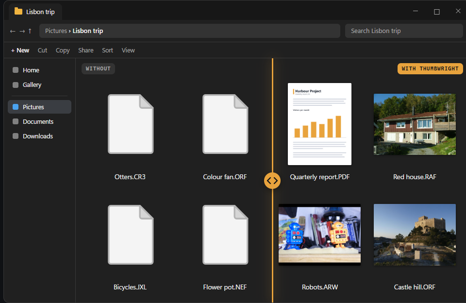
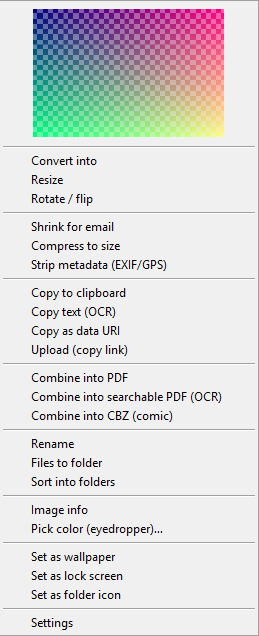

<h1 align="center">Thumbwright</h1>

<b>See your HEIC, RAW, PDF and CAD files in Explorer. Convert, resize and OCR from the right-click menu.</b> 
Free · open source · no internet access · Windows 10/11

## Install

- **Download:** [Thumbwright-&lt;version&gt;-x64.msi](https://github.com/DailenG/Thumbwright/releases/latest) from the latest release (signed, per-machine, needs admin).
- **Chocolatey:** `choco install thumbwright`
- **winget:** not yet.
- **Silent install:** `msiexec /i Thumbwright-<version>-x64.msi /qn`
- **Upgrade:** run the newer MSI the same way, or `choco upgrade thumbwright`.
- **Uninstall:** `msiexec /x Thumbwright-<version>-x64.msi /qn`, or `choco uninstall thumbwright`. It uninstalls cleanly; the registration is journaled and reversible.

- **Thumbnails only** (no right-click menu): `msiexec /i Thumbwright-<version>-x64.msi /qn MENU=0`. Pick a Starter kit with `KIT=photos|paperwork|design|cad|thumbnails|everything`; with Chocolatey, `choco install thumbwright --params "/Menu:0 /Kit:photos"`.

HEIC and HEIF photos (iPhone, Android, cameras) are decoded by Thumbwright itself and need no Microsoft Store codec. AVIF and AVCI thumbnails use the Microsoft Store AV1 and HEIF extensions; `twctl doctor` tells you whether they are present.

## What you get

### Thumbnails

Explorer shows real thumbnails for 315 file types: camera RAW, HEIC, AVIF, JPEG XL, PDF, Office and OpenDocument files, video frames, ebooks and comics, Photoshop, Krita, Blender and CAD previews, and more (see [Formats](#formats)). Risky decoding runs in a separate process, not inside Explorer.

### Right-click tools

On Windows 11, right-click > Thumbwright, or Shift + right-click, or Show more options. Select one file or many:

- Convert to JPEG, PNG, WebP, AVIF or JPEG XL
- Resize, and lossless JPEG rotate
- Shrink for email, or to under X MB
- Remove location and camera info
- Copy text from an image (OCR)
- Combine into one PDF, a searchable PDF or a CBZ
- Rename by date or camera, and sort into folders
- Set as lock screen or folder icon

### Command line

`twctl` runs every menu verb from a terminal or script, converts whole folders (`twctl batch`), warms the thumbnail cache (`twctl prebuild`) and checks your setup (`twctl doctor`). `twctl --mcp` is an MCP server over stdio, so an AI assistant can drive the same operations. `twctl --help` lists everything.

## Formats

315 of the 363 formats in the spec matrix have a thumbnail route. The other 48 are tracked in [docs/ARCHITECTURE.md](docs/ARCHITECTURE.md#format-coverage), and types without a route are never registered, so Windows' own handlers stay in charge.

| Family | Types | Examples |
|---|---:|---|
| Raster | 148 | JPEG, PNG, WebP, HEIC, AVIF, JPEG XL, JPEG 2000, TIFF, legacy bitmaps |
| Document | 46 | PDF, Word, Excel, PowerPoint, OpenDocument, Visio, DjVu, InDesign |
| Design | 31 | Photoshop, Illustrator, Affinity, Krita, Blender, DWG, DXF, FreeCAD, 3MF, G-code |
| CameraRaw | 30 | CR2, CR3, NEF, ARW, DNG, RAF, ORF and other camera RAW |
| Audio | 18 | cover art from tagged MP3, FLAC, M4A, Ogg, WMA |
| Video | 17 | frames from MP4, MKV, MOV, AVI, WebM |
| Ebook | 12 | EPUB, MOBI, AZW, FB2, CBZ, CBR |
| Package | 10 | app icon from APK/XAPK, NuGet, VSIX, Minecraft packs and worlds |
| Archive | 3 | ZIP, 7z, RAR (contact sheet) |

Run `twctl formats` for the full list, or use the lookup box on the [website](https://daileng.github.io/Thumbwright/#formats). CAD (DWG, DXF, FreeCAD, 3MF, G-code) is thumbnail-only: the thumbnail is the preview embedded in the file, not a render of the drawing.

## Safe by design

- **Offline.** No component opens a network connection: no upload, telemetry or update check ([SECURITY.md](SECURITY.md)).
- **Isolated decoders.** Risky decoding runs in `tw-worker.exe`, one process per request, inside a Job Object (512 MiB, 20 s CPU, kill-on-close).
- **Memory-safe Rust.** No C or C++ is compiled into any binary.
- **Reversible registration.** Every registry change is journaled. Thumbwright never changes an existing ProgID or default handler, and uninstall removes exactly what it wrote.
- **Signed binaries** with a `SHA256SUMS` checksum file for each release.

## Status and limits

- Pre-1.0: interfaces and on-disk formats may still change.
- Tested on Windows 11 build 26340. Windows 10 is not yet tested (classic menu only there).
- HEIC and HEIF are decoded by a built-in pure-Rust decoder (HEVC photos, grids, embedded thumbnails, rotation). Variants it cannot read, such as JPEG-coded HEIF items, fall back to the Microsoft HEIF and HEVC Store extensions if installed. Known limit: the transparency channel Apple writes for portrait-mode cutouts is not applied, so those images show opaque. AVIF and AVCI thumbnails need the Microsoft Store extensions (AV1, HEIF).
- Video frames use Media Foundation. "N" editions of Windows need the Media Feature Pack.
- File types already owned by another program (for example a cloud-storage app's thumbnail handler) are left alone. Thumbwright never takes over another app's handler automatically, and `twctl doctor` lists them.
- Windows' own handler wins for some types, such as .jpg (Photo Thumbnail Provider) and .ico.

## Troubleshooting

Run `twctl doctor`: it checks each part and prints a fix hint for every problem. To report one, run `twctl doctor --bundle out.zip` and attach `out.zip` to an [issue](https://github.com/DailenG/Thumbwright/issues). If thumbnails look stale after a change, use Rebuild thumbnail cache on the Maintenance page of Thumbwright settings. The log is `%LOCALAPPDATA%\Thumbwright.log` ([details](docs/DEVELOPING.md#diagnostics-log)).

## FAQ

Why do my HEIC files have no thumbnail?

HEIC and HEIF thumbnails are built in and need no Microsoft Store codec, so a missing thumbnail usually means the file is damaged, uses a variant the built-in decoder does not support (it then tries Windows' codecs, if installed), or another program owns .heic; see the next question. Run `twctl doctor` on the file.

Why does another app still own .jpg or .heic?

Thumbwright never changes an existing handler on its own. A cloud-storage app may already own a type, and Windows keeps its own Photo Thumbnail Provider for .jpg. `twctl doctor` lists what is owned elsewhere.

How do I get the full menu?

Shift + right-click, or choose Show more options on the Windows 11 menu.

How do I uninstall it?

Apps > Installed apps > Thumbwright > Uninstall, or `msiexec /x Thumbwright-<version>-x64.msi /qn`, or `choco uninstall thumbwright`.

Does it phone home?

No. No component opens a network connection, and there is no telemetry or update check.

Is it safe for corrupt or hostile files?

Risky decoders run in an isolated process with memory and CPU limits. If one fails, only that process dies and Explorer keeps running.

## Contributing and building

See [CONTRIBUTING.md](CONTRIBUTING.md). Build steps, components, packaging and signing are in [docs/DEVELOPING.md](docs/DEVELOPING.md).

## Provenance

Thumbwright is an independent clean-room implementation, built from [FUNCTIONAL_SPEC.md](FUNCTIONAL_SPEC.md), official Microsoft documentation and permissively licensed crates. The product it is modelled on is deliberately not named.

## License

Copyright (C) 2026 Dailen Gunter

Thumbwright is free software: you can redistribute it and/or modify it under the terms of the GNU General Public License as published by the Free Software Foundation, either version 3 of the License, or (at your option) any later version. It is distributed in the hope that it will be useful, but WITHOUT ANY WARRANTY; without even the implied warranty of MERCHANTABILITY or FITNESS FOR A PARTICULAR PURPOSE. See `LICENSE` for the full text (`GPL-3.0-or-later`).

Third-party notices: `THIRD_PARTY_LICENSES.md`.
